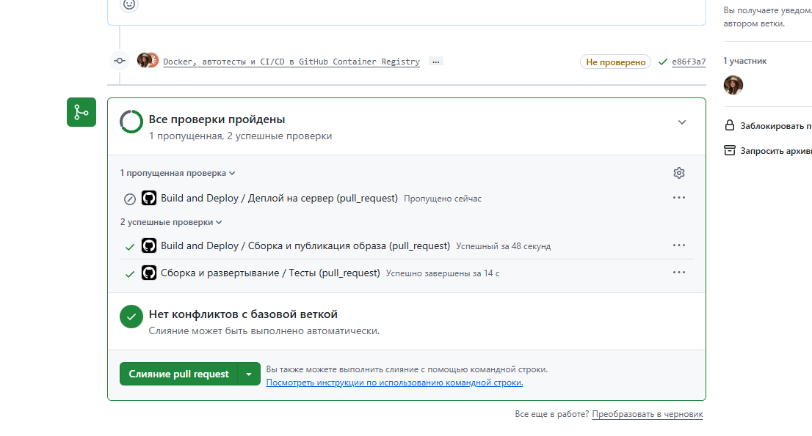
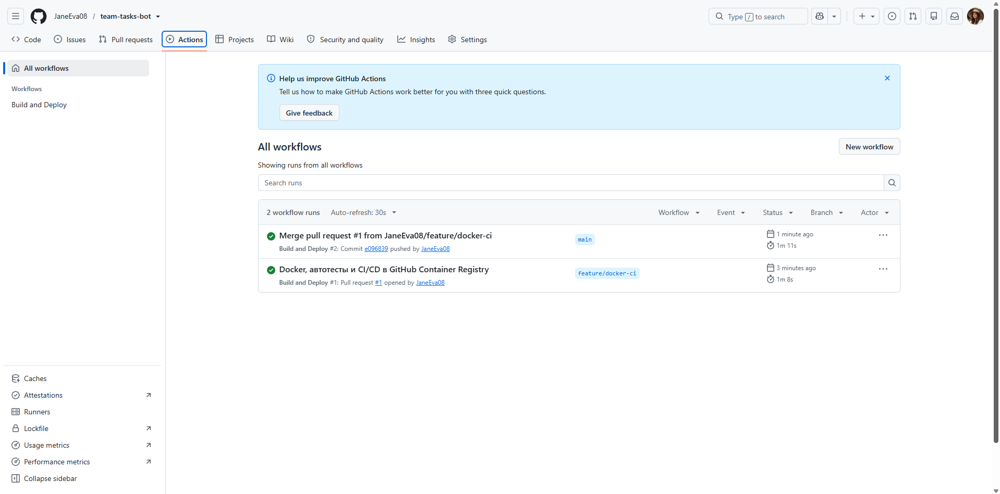
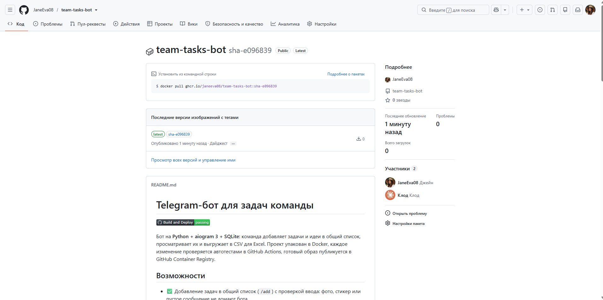

# ДЗ VPe04 «Автодеплой бота: GitHub Actions, Docker и GitFlow»

**Студент:** Евгения Толстых
**Проект:** Telegram-бот задач команды (aiogram 3 + SQLite), сделанный ранее в уроке VPb06
**Репозиторий:** https://github.com/JaneEva08/team-tasks-bot

Вместо учебного приложения из урока взяла свой рабочий бот: так ДЗ заодно доводит до порядка реальный проект из портфолио.

## Что сделано по заданию

| Пункт задания | Где |
|---|---|
| 1. Простой проект | Бот на aiogram 3, без изменений в логике команд |
| 2. `.github/workflows/deploy.yml`, запуск при push в main | [deploy.yml](.github/workflows/deploy.yml) — `on: push: branches: [main]` |
| 2. Сборка Docker-образа | [Dockerfile](Dockerfile), job «Сборка и публикация образа» |
| 2. Пуш в GitHub Container Registry | Шаг «Отправить образ в реестр» → `ghcr.io/janeeva08/team-tasks-bot` |
| 3. ⭐ Деплой по SSH | Job «Деплой на сервер» написан, включается переменной `DEPLOY_ENABLED` после аренды сервера |
| 4. Workflow отработал | Вкладка [Actions](https://github.com/JaneEva08/team-tasks-bot/actions) |
| 5. Проект на GitHub | Этот репозиторий |

## GitFlow

Работа велась в ветке `feature/docker-ci` → pull request в `main`. На PR workflow запускает тесты и пробную сборку образа, но **не публикует** его. Публикация происходит только после слияния. Для одного разработчика ветка `develop` избыточна, поэтому схема упрощённая: `feature/* → main`.

## Что добавила сверх задания

**Автотесты как отдельный job.** 27 тестов pytest на базу и обработчики команд. Сборка образа не начнётся, если тесты упали (`needs: test`). Тесты не требуют токена и не ходят в Telegram.

**Проверка готового образа перед публикацией.** Образ запускается на раннере: код импортируется, бот работает не от root, база записывается в том `/app/data`. Сломанный образ в реестр не попадёт.

**Безопасность образа.**
- `.dockerignore` исключает `.env`, базы, CSV-выгрузки: токен и данные пользователей не могут утечь в публичный образ.
- Бот запускается от отдельного пользователя, не root; писать может только в `/app/data`.
- База вынесена в том — переживает обновление контейнера.

**Ошибки урока, которые учла.**
| В уроке | Как сделано здесь |
|---|---|
| Деплой срабатывает и на pull request — на сервер уходит ещё не слитый код | Деплой только при `push` в main |
| `${{ github.repository }}` в имени образа — у владельца `JaneEva08` заглавные буквы, ghcr.io их не принимает | Имя приводится к нижнему регистру |
| Вход на сервер под root | В секретах — отдельный пользователь `deploy` |
| Старый образ удаляется до запуска нового — откатиться некуда | Теги `sha-<коммит>`, проверка контейнера через 15 с и автооткат на прошлую версию |
| Версии пакетов удаляются из `requirements.txt` | Версии зафиксированы — сборка воспроизводима |

**Найденные ошибки в самом боте (QA).**
1. Если в ответ на `/add` прислать фото или стикер, бот падал с `IntegrityError: NOT NULL constraint failed` — у сообщения нет текста. Теперь бот просит прислать задачу текстом. Тест `test_non_text_message_does_not_crash` на старом коде падает, на новом проходит.
2. `/list` при большом числе задач превышал лимит Telegram в 4096 символов — сообщение не отправлялось. Теперь список делится на несколько сообщений.
3. CSV-выгрузка писалась в папку с кодом — в контейнере от непривилегированного пользователя это не сработало бы. Теперь файл создаётся во временной папке и удаляется после отправки.

## Результат

| Что | Итог |
|---|---|
| PR #1 `feature/docker-ci → main` | тесты ✅, пробная сборка образа ✅, публикации нет, деплой пропущен |
| Запуск на `main` после слияния (коммит `e096839`) | тесты ✅ → сборка ✅ → проверка образа ✅ → пуш в ghcr.io ✅, деплой пропущен (сервер не подключён) |
| Пакет | [ghcr.io/janeeva08/team-tasks-bot](https://github.com/JaneEva08/team-tasks-bot/pkgs/container/team-tasks-bot), публичный, теги `latest` и `sha-e096839` |

Скачать и запустить образ:

```bash
docker run -d --name team-tasks-bot -e BOT_TOKEN=<токен> -v bot-data:/app/data ghcr.io/janeeva08/team-tasks-bot:latest
```

## Скриншоты

**1. Pull request: все проверки пройдены до слияния**



**2. Actions: запуск на PR и запуск на main после слияния**



**3. Опубликованный образ в GitHub Container Registry**


